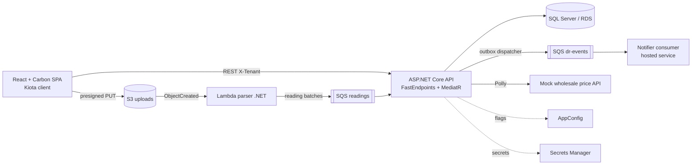

# Grid Meter Cloud

[](https://github.com/mini4141/grid-meter-cloud/actions/workflows/ci.yml)

A multi-tenant energy data platform in .NET 10 (ASP.NET Core, EF Core, CQRS) on AWS. Energy retailers (tenants) manage sites and smart meters and upload half-hourly reading files. A Lambda parses each file when it lands in S3, the readings travel over SQS and are ingested idempotently through an inbox, and the React + Carbon Design System front end turns them into consumption dashboards, feature-flagged bill estimates and demand-response events published through a transactional outbox.

The Azure services a typical enterprise .NET stack uses are mapped one-to-one to AWS: see [docs/azure-to-aws.md](docs/azure-to-aws.md).

## Architecture



Clean Architecture layers (`Domain` <- `Application` <- `Infrastructure` <- `Api`, enforced by a NetArchTest test). Every write is a MediatR command; pipeline behaviours run FluentValidation and wrap the handler in a DB transaction that also stores outbox rows. Multi-tenancy uses Finbuckle (`X-Tenant` header or host) with per-tenant EF Core query filters. See [docs/eventstorming.md](docs/eventstorming.md) for the domain flow.

## Quickstart (local, no AWS calls)

Prerequisites: .NET 10 SDK, Node.js 24 + pnpm, Docker Desktop, Nuke (`dotnet tool install -g Nuke.GlobalTool`), Kiota.

```bash
scripts/dev-up.sh      # SQL Server, moto (S3/SQS), price mock, migrations, API, parser runner, web + demo data
scripts/test-all.sh    # xUnit (unit, architecture, integration), Vitest, lint, Playwright e2e
scripts/dev-down.sh
```

- Web: http://localhost:5173 (sign in as `aurora-power` or `kita-denki`)
- API + Swagger: http://localhost:8085/swagger
- Locally `MeterParser.LocalRunner` plays the S3 trigger: it polls the moto bucket and runs the same parser code as the Lambda.

Other commands: `nuke Compile Test Publish DockerBuild GenerateClient` (Nuke build), `scripts/seed.sh`, `scripts/capture-proof.sh phase1`.

## Deploy to AWS and destroy

Everything is created by AWS CDK v2 (C#) in `infra/GridMeter.Infra` and deployed from this machine with the `grid-meter-cloud-deployer` profile in `ap-southeast-2`. GitHub Actions only builds and tests.

```bash
scripts/deploy.sh                    # build, bootstrap, cdk deploy, run EF migrations as an ECS task, upload the SPA
scripts/capture-proof.sh phase2      # cloud e2e, screenshots and logs
scripts/destroy.sh                   # empty buckets, cdk destroy, delete the bootstrap stack
scripts/verify-destroyed.sh          # fails if anything billable is left
```

The stack is meant to live for hours, not days: it costs a few dollars per day (RDS, ALB, Fargate).

## More

- Proof of everything running: [proof/README.md](proof/README.md)
- Write-up for the portfolio page: [docs/PORTFOLIO.md](docs/PORTFOLIO.md)
- Decisions log: [docs/DECISIONS.md](docs/DECISIONS.md) · AI usage: [docs/AI_USAGE.md](docs/AI_USAGE.md)
