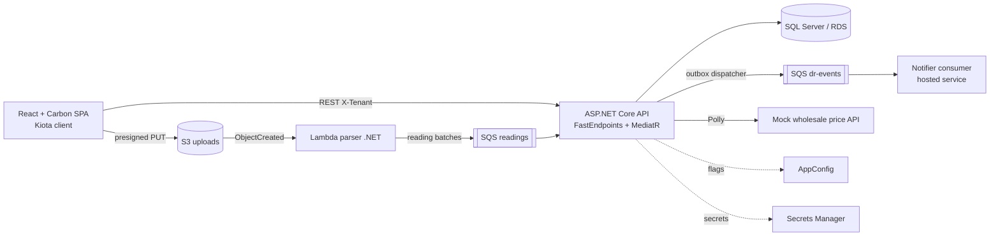

# SPECS.md: Grid Meter Cloud

## 1. Summary

A multi-tenant **EnergyTech SaaS** for electricity retailers, with three main capabilities:

- **Ingestion.** Each retailer (tenant) manages its sites and smart meters and uploads half-hourly meter reading files (CSV). A Lambda parses each file when it lands in S3 and sends reading batches to SQS. The API's consumer ingests them idempotently.
- **Dashboards and billing estimates.** Operators see consumption charts. When the `tariff-estimates` feature flag is on, they also see an estimated bill, priced from an external wholesale-price API that is called through Polly resilience.
- **Demand-response events.** These flow out through a transactional outbox.

The backend is .NET 10 Clean Architecture with CQRS. The front end is React with IBM's Carbon Design System. The Azure services named in the post are mapped one-to-one to AWS.

**Demo story:**
1. Log in as `aurora-power` and add a site and a meter.
2. Upload `readings-2026-11.csv`.
3. Within seconds the dashboard shows daily kWh.
4. Toggle the flag, and the bill estimate appears (it survives a flaky price API).
5. Issue a demand-response event and see it published through the outbox.
6. Switch to `kita-denki`: none of aurora's data is visible.

## 2. Requirement coverage matrix

| Requirement | Covered by | Proof |
|---|---|---|
| Web apps with C# + ASP.NET Core | Api project + FastEndpoints | Swagger screenshot |
| EF Core database development | DbContext, migrations, query filters | Migration log |
| Design + implement REST APIs | OpenAPI + Kiota | Generated client |
| Automated unit tests | xUnit | Test report |
| OO design + patterns | DDD aggregates, Mediator, Strategy (Finbuckle), Outbox | Code + docs |
| Relational DB (SQL Server) | SQL Server container / RDS SQL Server | Logs |
| Cloud systems (Azure → AWS) | ECS, Lambda, SQS, S3, AppConfig, Secrets Manager | resources.txt |
| Agile / Scrum | GitHub Projects board + issues per feature | Board screenshot |
| Agent-driven development + harness engineering (preferred) | `docs/AI_USAGE.md` (Claude Code workflow, test harness as guardrail) | Doc |
| DDD, EventStorming, Clean Architecture | Layering + `docs/eventstorming.md` + NetArchTest | Test + doc |
| CQRS, Mediator, Inbox/Outbox | MediatR + outbox/inbox tables | Integration test + logs |
| React + Carbon Design System | `web/` | Screenshots |
| FastEndpoints, Finbuckle, FluentValidation, Polly, xUnit | Named libraries in use | Code + tests |
| Vite, SCSS, ESLint, Stylelint, Playwright, Vitest, RTL, Kiota | `web/` toolchain | CI |
| Nuke, Docker Compose, GitHub Actions | Build + CI | CI run |

## 3. Architecture



## 4. Repository layout

```
src/GridMeter.Domain/   src/GridMeter.Application/   src/GridMeter.Infrastructure/   src/GridMeter.Api/
src/GridMeter.MeterParser.Lambda/   src/GridMeter.PriceMock/   src/GridMeter.Notifier/ (hosted in Api or separate)
tests/GridMeter.UnitTests/   tests/GridMeter.IntegrationTests/   tests/GridMeter.ArchTests/
web/                    React + Vite + Carbon (src/api/generated = Kiota)
build/                  Nuke build project
infra/GridMeter.Infra/  CDK (C#)
docker-compose.yml      sqlserver, moto, pricemock, api, web
docs/                   azure-to-aws.md, eventstorming.md, DECISIONS.md, AI_USAGE.md, PORTFOLIO.md
```

## 5. Features (end-to-end)

### F1: Tenant-aware sites and meters
- A Carbon `DataTable` lists sites (name, region, meter count). There's a create-site modal and a meter add form (MPAN-like ID, type).
- Commands are `CreateSite` and `AddMeter`, each with a FluentValidation validator. The queries are `ListSites` and `GetSite`.
- **Accept:** creating a site in `aurora-power` doesn't make it visible in `kita-denki`. The integration test asserts this.

### F2: Meter file upload → serverless parse → queue
- The SPA requests a presigned URL (`POST /uploads`) and PUTs the CSV (`meter_id,timestamp,kwh` at 30-minute intervals).
- An S3 event triggers the Lambda, which parses the file, validates rows and sends batches of 100 to `readings` SQS with a `tenant` attribute.
- **Accept:** a 1 month × 2 meters file produces about 30 messages (logged).

### F3: Idempotent ingestion (Inbox)
- A hosted service in the API long-polls `readings`. For each message it writes an `inbox(message_id)` row and the readings in one transaction. Duplicate messages are skipped.
- **Accept:** reprocessing the same message doesn't duplicate readings (integration test).

### F4: Consumption dashboard
- Carbon charts: a daily kWh line, per-meter bars and a peak-demand tile.
- The query `GetConsumption(siteId, from, to)` is projected with EF Core `AsNoTracking`.
- **Accept:** the chart renders the uploaded month.

### F5: Feature-flagged bill estimate with resilient price calls
- Flag `tariff-estimates` comes from AppConfig in AWS and from appsettings locally.
- When it's on, the dashboard calls `GET /sites/{id}/estimate`, which calls the mock wholesale price API through a Polly pipeline (retry 3× with jittered backoff, circuit breaker). The price mock has `FAIL_RATE=0.5`.
- **Accept:** the estimate appears despite the 50% failures, the logs show retries, and turning the flag off hides the panel.

### F6: Demand-response events (Outbox)
- The command `IssueDemandResponse(siteId, window, targetKw)` persists the aggregate change plus an outbox row in one transaction. The dispatcher publishes to the `dr-events` SQS queue, and the Notifier consumes it and logs a "customer notified" line.
- **Accept:** the outbox row shows as processed, and the Notifier log has the event.

### F7: Agile board and EventStorming
- Phase 0 creates GitHub issues for F1–F8 and a Project board through `gh`. `docs/eventstorming.md` holds the Mermaid flow: domain events, commands and policies.
- **Accept:** a screenshot of the board.

### F8: Ops basics
- `/healthz`, `/readyz` (DB + SQS) and JSON logging with Serilog or the built-in JSON console. An admin page in the SPA shows the build info and the flag state.

## 6. Data model

- `Tenants` (Finbuckle store, in config or a table)
- `Sites(Id, TenantId, Name, Region)`
- `Meters(Id, TenantId, SiteId, ExternalId, Type)`
- `Readings(TenantId, MeterId, IntervalStart, Kwh)` with PK (MeterId, IntervalStart)
- `DemandResponseEvents(Id, TenantId, SiteId, WindowStart, WindowEnd, TargetKw, Status)`
- `OutboxMessages(Id, Type, Payload, OccurredAt, ProcessedAt)`
- `InboxMessages(MessageId, ReceivedAt)`

## 7. Interfaces

- `GET/POST /sites`
- `GET /sites/{id}`
- `POST /sites/{id}/meters`
- `POST /uploads` (presign)
- `GET /sites/{id}/consumption?from&to`
- `GET /sites/{id}/estimate`
- `POST /sites/{id}/demand-response`
- `GET /admin/info`
- `GET /swagger`

The tenant comes from the `X-Tenant` header. Auth is a simple dev JWT per tenant user.

## 8. Test plan

| Layer | Test |
|---|---|
| xUnit unit | `CreateSite` handler; validator rejects an empty name; `DemandResponse` aggregate emits a domain event; CSV parser |
| Integration | Tenant isolation; inbox dedupe; outbox row processed |
| Arch | NetArchTest layering |
| Vitest/RTL | Sites page renders a DataTable from a mocked Kiota client |
| Playwright | Login → create site + meter → upload CSV → dashboard chart visible → flag estimate visible |

## 9. Phase 1: Local

`docker compose up`: sqlserver, moto, pricemock, api (dotnet), web (vite). A local Lambda stand-in, `MeterParser.LocalRunner`, polls a moto S3 prefix or receives a moto S3 notification. Use the simplest reliable option and document it.

- [ ] `tests/`: xUnit TRX→JUnit, Vitest, Playwright report
- [ ] `screenshots/01-sites-carbon-table.png`, `02-upload.png`, `03-consumption-chart.png`, `04-estimate-flag-on.png`, `05-dr-event.png`, `06-tenant-switch-isolation.png`, `07-swagger.png`, `08-github-project-board.png`
- [ ] `logs/polly-retries.log`, `logs/outbox-dispatch.log`, `logs/nuke-build.log`, `logs/ef-migrations.log`

## 10. Phase 2: AWS

| Azure (job post) | Local | AWS |
|---|---|---|
| App Service (container) | dotnet api container | ECS Fargate + ALB |
| Azure Functions | LocalRunner | Lambda (.NET) with S3 trigger |
| Azure SQL Database | SQL Server 2022 container | RDS SQL Server Express |
| Storage Queues | moto SQS | SQS (+ DLQ) |
| Blob Storage | moto S3 | S3 |
| App Configuration flags | appsettings | AppConfig application/env/profile (feature flags) |
| Key Vault | user-secrets | Secrets Manager (DB connection string) |

`scripts/deploy.sh`:
1. `nuke Publish DockerBuild`.
2. `cdk bootstrap` (qualifier).
3. `cdk deploy`.
4. Run the EF migrations through a one-off ECS task.
5. Upload the SPA to S3.
6. Playwright against CloudFront.

- [ ] `screenshots/01-cloud-dashboard.png`, `02-cloud-estimate.png`, `03-cloud-tenant-isolation.png`
- [ ] `logs/lambda-parser.log`, `logs/appconfig-flag-toggle.log`, `logs/cdk-deploy.log`, `resources.txt`
- [ ] `tests/playwright-cloud/`

## 11. Phase 3: Destroy

`cdk destroy --all --force`, then delete the toolkit stack and bucket.

`verify-destroyed.sh` checks for no RDS instance, ECS cluster, Lambda function, SQS queues, AppConfig application or secrets.

## 12. Out of scope

Real meter protocols, settlement, Japanese regulatory logic (noted in the portfolio as a domain extension), and SSO.
