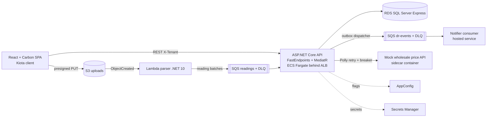
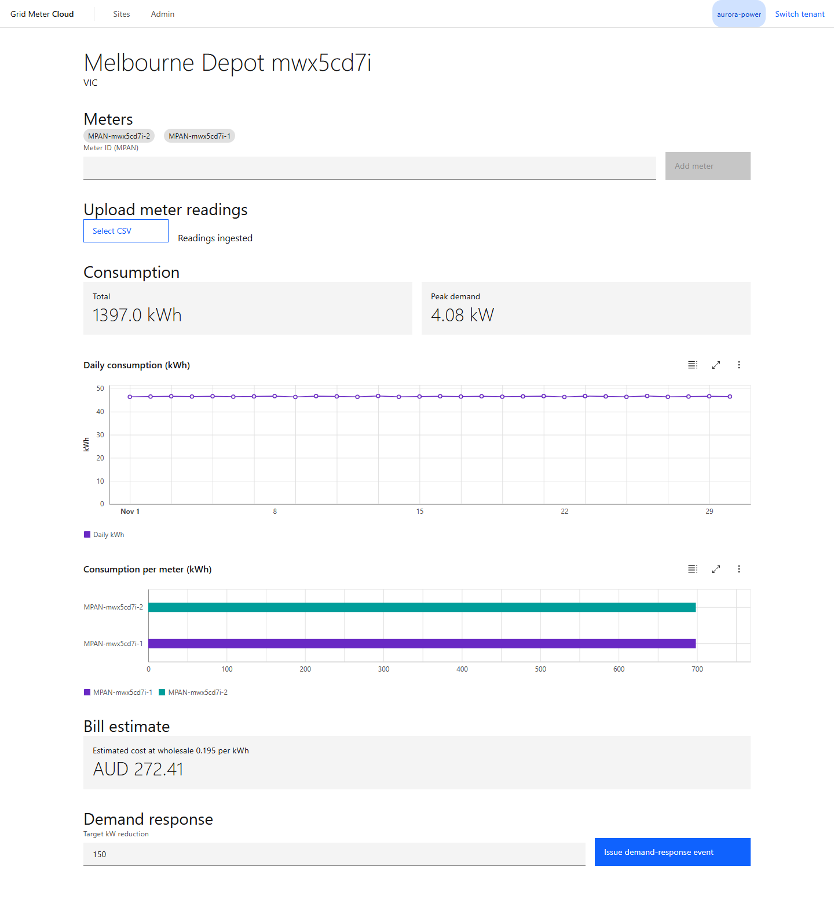
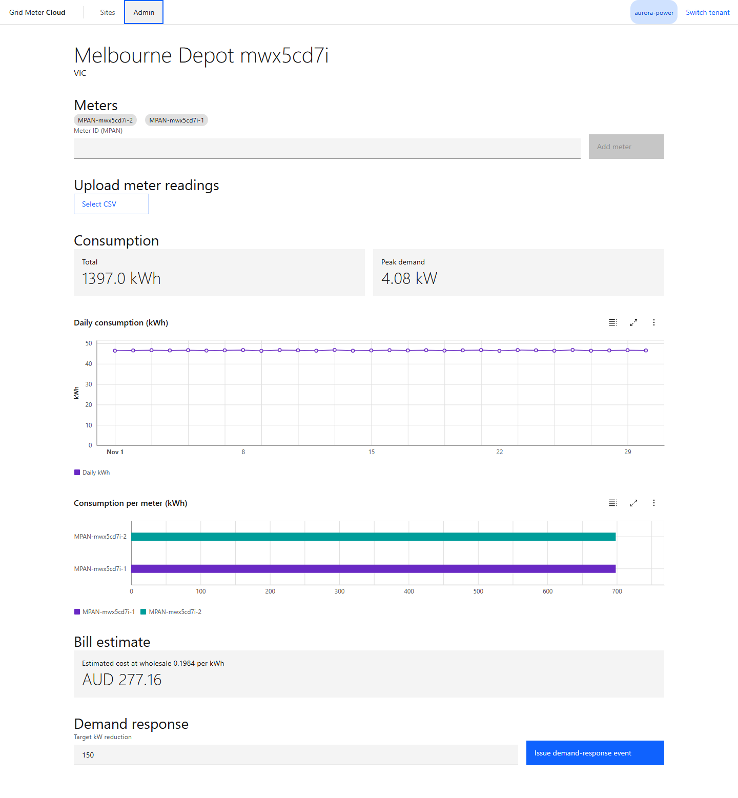
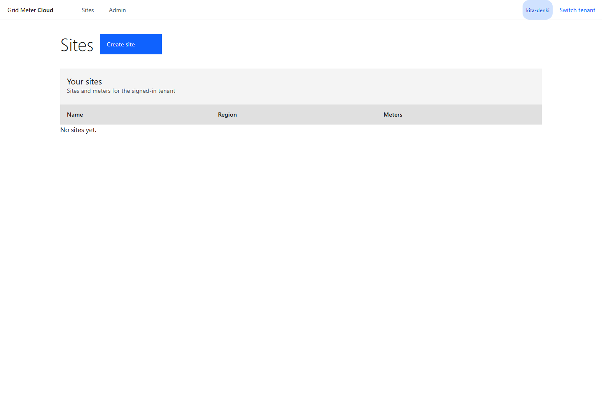
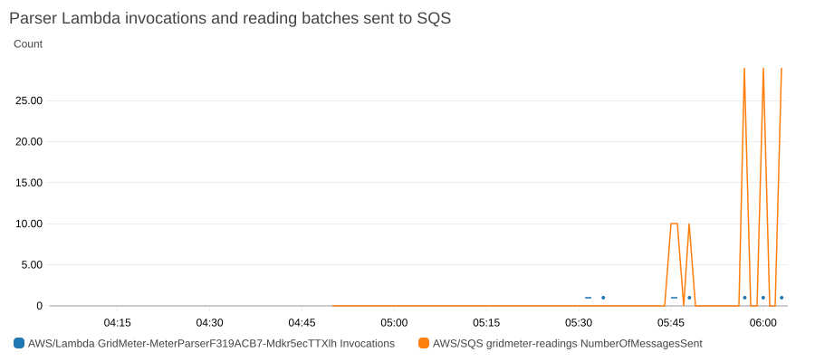

# Grid Meter Cloud: a multi-tenant energy data platform on .NET and AWS

## The problem

Electricity retailers collect half-hourly readings from thousands of smart meters. Each retailer needs its own isolated view of its sites and meters, files arrive in bursts, the same file may be delivered twice, a wholesale price feed is unreliable, and operators need to ask customers to cut demand without losing or duplicating the request.

Grid Meter Cloud is a deliberately broad slice of that problem. Retailers (tenants) upload reading files; a serverless parser turns them into queue messages; the API ingests them exactly once; operators see consumption dashboards and a feature-flagged bill estimate; and demand-response events leave the system through a transactional outbox. The point of the project is breadth across a modern .NET + cloud stack, wired together and proven running, rather than depth in the energy-retail domain.

## Architecture



- **Clean Architecture**: `Domain` (aggregates, domain events, no references) <- `Application` (MediatR commands/queries, validators, pipeline behaviours) <- `Infrastructure` (EF Core, SQS, S3, Polly) <- `Api` (FastEndpoints). A NetArchTest test fails the build if a layer depends on one it should not.
- **CQRS + transactional outbox/inbox**: every write is a MediatR command. One pipeline behaviour runs FluentValidation; another wraps the handler in a DB transaction and turns the domain events raised by aggregates into `OutboxMessages` rows in the same commit. A hosted `OutboxDispatcher` publishes them to SQS. On the way in, each reading batch carries a batch id that is recorded in `InboxMessages` in the same transaction as the readings, so redelivered messages are skipped.
- **Multi-tenancy** with Finbuckle (`X-Tenant` header or host strategy) and a global EF Core query filter on every tenant-owned table. One integration test proves tenant A cannot read tenant B's data.
- **Contract first front end**: FastEndpoints.Swagger publishes the OpenAPI document and Kiota generates the TypeScript client, which a Nuke target regenerates and which is committed so the web build does not need the API running.
- The domain flow is documented as an EventStorming board in [eventstorming.md](eventstorming.md).

## Stack against requirements

| Requirement | What was built | Evidence |
|---|---|---|
| Web apps with C# + ASP.NET Core | .NET 10 API with FastEndpoints | [Swagger](../proof/phase1-local/screenshots/07-swagger.png) |
| EF Core + relational DB | EF Core migrations on SQL Server (container locally, RDS SQL Server Express in AWS), per-tenant query filters | [migrations](../proof/phase1-local/logs/ef-migrations.log), [cloud migration](../proof/phase2-cloud/logs/ef-migrations-cloud.log) |
| REST API design | OpenAPI + generated Kiota TypeScript client | `web/src/api/generated` |
| Automated tests | xUnit unit, `WebApplicationFactory` + Testcontainers integration, NetArchTest, Vitest + RTL, Playwright | [reports](../proof/phase1-local/tests) |
| DDD, CQRS, Mediator, Inbox/Outbox | Aggregates raising domain events, MediatR, behaviours, outbox dispatcher, inbox dedupe | [outbox log](../proof/phase1-local/logs/outbox-dispatch.log) |
| FluentValidation, Polly, Finbuckle | Validators in the pipeline; retry + circuit breaker on the price client; tenant resolution + query filters | [Polly log](../proof/phase1-local/logs/polly-retries.log), [isolation](../proof/phase1-local/screenshots/06-tenant-switch-isolation.png) |
| React + Carbon Design System | Carbon `DataTable`, modals, tiles, `@carbon/charts-react` | [sites](../proof/phase1-local/screenshots/01-sites-carbon-table.png), [dashboard](../proof/phase1-local/screenshots/03-consumption-chart.png) |
| Vite, SCSS, ESLint, Stylelint, Playwright, Vitest | `web/` toolchain, all run in CI | [CI workflow](../.github/workflows/ci.yml) |
| Nuke, Docker Compose, GitHub Actions | `build/Build.cs` (Compile, Test, Publish, DockerBuild, GenerateClient), `docker-compose.yml`, CI calling Nuke | [Nuke log](../proof/phase1-local/logs/nuke-build.log) |
| Cloud systems (Azure to AWS) | ECS Fargate + ALB, Lambda, RDS, SQS, S3, AppConfig, Secrets Manager, all from CDK C# | [resources](../proof/phase2-cloud/resources.txt), [mapping](azure-to-aws.md) |
| Feature flags + config + secrets | `Microsoft.FeatureManagement` over AppConfig; DB credentials and JWT key in Secrets Manager | [flag toggle](../proof/phase2-cloud/logs/appconfig-flag-toggle.log) |
| Agile / project management | GitHub issues F1-F8 | [issues](../proof/phase1-local/screenshots/08-github-project-board.png) |
| Agent-driven development | Built with Claude Code against a spec; the test harness is the guardrail | [AI_USAGE.md](AI_USAGE.md) |

### Azure to AWS

| Azure | AWS |
|---|---|
| App Service (containers) | ECS on Fargate behind an ALB |
| Functions | Lambda (.NET 10) with an S3 trigger |
| Azure SQL Database | RDS for SQL Server Express |
| Storage Queues / Blob | SQS (with DLQs) / S3 |
| App Configuration + feature flags | AppConfig + `Microsoft.FeatureManagement` |
| Key Vault | Secrets Manager |
| Azure DevOps Boards / Pipelines | GitHub Issues / GitHub Actions + Nuke |

## Running in the cloud

Everything below ran on AWS (`ap-southeast-2`), created and destroyed by script.

| | |
|---|---|
| Dashboard after uploading a month of readings for two meters through S3 -> Lambda -> SQS -> API |  |
| Bill estimate after flipping the flag in AppConfig, priced through a mock API that fails half its calls |  |
| Switching tenant: none of `aurora-power`'s data is visible to `kita-denki` |  |
| Parser Lambda invocations and reading batches sent to SQS (CloudWatch) |  |

Locally the same flow runs on Docker Compose with moto standing in for S3/SQS: [upload](../proof/phase1-local/screenshots/02-upload.png), [demand-response event published through the outbox](../proof/phase1-local/screenshots/05-dr-event.png), and the [Playwright run](../proof/phase1-local/tests).

After capturing, `scripts/destroy.sh` removed everything and [verify-destroyed.txt](../proof/phase3-destroy/verify-destroyed.txt) shows nothing billable left.

## What was hard

- **A Lambda on a brand-new runtime.** The .NET 10 managed runtime refused the class-library package until a `.runtimeconfig.json` was generated next to it (`GenerateRuntimeConfigurationFiles`). Locally this never showed because the parser runs as a console host.
- **SDK differences between a local emulator and AWS.** With AWSSDK v4, moto returned a checksum header that made SQS receive calls fail, so locally the SQS client drops that header. In real AWS the opposite bug appeared: `SendMessageBatch` returns a null `Failed` list when nothing failed, which crashed the Lambda after the first 10 messages. The retry was harmless because batch ids make ingestion idempotent, which is the inbox doing its job, but it was an unplanned test of it.
- **EF Core details that only fail at runtime.** A query that did not translate (ordering after a constructor projection), Guid keys being tracked as updates instead of inserts, and EF 10's pending-model-changes check all surfaced through the integration tests rather than at compile time.
- **Tiny databases are slow.** On `db.t3.micro` the SQL Server Express instance exhausted its CPU credits and memory, and a list query took 25 seconds. `db.t3.small` fixed it.
- **Account-level surprises.** CloudFront refused to create a distribution until the (new) account is verified, so the SPA is served from an S3 website with CORS on the API; the CloudFront variant remains in the CDK stack behind `-c cloudfront=true`. Destroying also needed care: AppConfig deletion protection blocks deleting a recently polled environment, and deleting the CDK bootstrap stack too early strands the app stack. `scripts/destroy.sh` now handles both and is safe to re-run.
- **No console.** All AWS-side proof is rendered from the CLI (CloudWatch metric widget images, describe output), and every artifact is produced by `scripts/capture-proof.sh` so it can be reproduced.

## Cost

The cloud stack was alive for roughly two and a half hours including several fix-and-redeploy cycles. Rough estimate from list prices, not from billing data: RDS `db.t3.small` SQL Server Express plus storage, one ALB and one 0.5 vCPU / 1 GB Fargate task come to well under USD 2 for that window; Lambda, SQS, S3, AppConfig and Secrets Manager were negligible. There are no NAT gateways, Multi-AZ databases or reserved capacity.

## Reproduce it

```bash
scripts/dev-up.sh                 # local stack + demo data
scripts/test-all.sh               # every local test layer
scripts/capture-proof.sh phase1   # screenshots, logs and reports into proof/phase1-local

scripts/deploy.sh                 # needs the grid-meter-cloud-deployer AWS profile (PowerUserAccess + IAMFullAccess)
scripts/capture-proof.sh phase2
scripts/destroy.sh && scripts/verify-destroyed.sh
```

Out of scope on purpose: real meter protocols, settlement, regional regulatory logic (a natural domain extension, for example Japanese market rules) and SSO.
