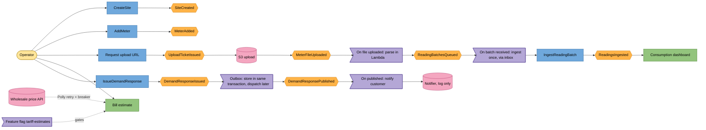

# EventStorming board

Big-picture board for the Grid Meter Cloud domain. Orange = domain event, blue = command, yellow = actor, purple = policy, pink = external system, green = read model.

## Aggregates and boundaries

| Aggregate | Commands | Events |
|---|---|---|
| `Site` (with `Meter`) | CreateSite, AddMeter | SiteCreated, MeterAdded |
| `DemandResponseEvent` | IssueDemandResponse | `DemandResponseIssued` (raised in the domain, persisted through the outbox) |
| Readings (ingestion) | IngestReadingBatch (idempotent through the inbox) | ReadingsIngested |

Every tenant-owned aggregate carries a `TenantId` that Finbuckle enforces with a global EF query filter.
